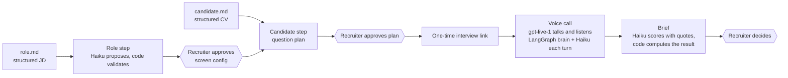

# Recruiter Voice Agent

A voice agent for first-round recruiter screens. A recruiter imports a job description and a CV; the agent
prepares questions for that job and that candidate, holds a 10–15 minute voice interview in the browser, checks
what the candidate claims, and writes a scored, evidence-backed brief for the hiring manager. The recruiter
approves each step.

**Today** it supports Account Executive (AE) roles at tech and AI companies in Asia: the interview stages, rubric
and domain checks (quota, attainment, deal size, sales motion) are written for AE hiring, with market presets for
India and Singapore. Any AE job description that follows [the input format](docs/INPUT_SPEC.md) already gets its
own screen configuration.

**Where it is going:** one-click import for other roles. Each job family needs its own interview layer (stages,
rubric, checks), and raw job descriptions and CVs need an extractor in front; neither exists yet.

It is a working prototype. All candidates are synthetic; the two job descriptions come from public postings.

## How it works



- **The voice** is OpenAI `gpt-live-1`, full duplex: it hears the candidate directly, handles turn taking and
  interruptions, and keeps the conversation natural.
- **The brain** is a LangGraph graph that runs once per candidate turn. Claude Haiku 5.5 judges the answer;
  code decides what to ask next, records evidence, and checks the numbers.
- **The rules live in code and content**: the same questions and fields for every candidate of a role, no CV
  number read out before the candidate states it (blind recall), no protected attributes, and a strict
  three-strike rule for candidates who will not engage.

More detail: [docs/ARCHITECTURE.md](docs/ARCHITECTURE.md).

## Run it

Needs Python 3.12+, [uv](https://docs.astral.sh/uv/), Node 22+, and two API keys.

```bash
export OPENAI_API_KEY=...       # the voice model
export ANTHROPIC_API_KEY=...    # the brain, question generator and brief
uv sync --group alt
(cd alt/frontend && npm ci && npm run build)
uv run --group alt uvicorn alt.app:app --port 8100
```

On macOS you can store the keys in the Keychain instead: `uv run python -m backend.keystore set OPENAI_API_KEY`.

1. Open http://127.0.0.1:8100 (the recruiter console). Both demo roles are already approved.
2. Under **Invite a candidate**, pick a candidate and a job, then **Prepare interview questions**.
3. Review and approve the question plan; copy the interview link.
4. Open the link in another tab as the candidate (use headphones) and talk.
5. Watch the session page live: transcript, evidence, flags, latency, cost. The brief appears after the call.

To play a candidate convincingly, `data/candidates/arjun_inflated_attainment/demo_pack.md` gives you the facts and a
planted inconsistency for the agent to catch.

**Cost:** a call is about USD 0.05 per minute (voice) plus about USD 0.001 per minute (Haiku). Preparing a plan or
a brief costs about a cent. Every call is logged to `runs/costs.jsonl`, and spend is capped in `alt/config.yaml`.

```bash
uv run --group alt pytest -q                        # tests, no API calls
uv run --group alt python -m alt.eval.adversarial   # 18 simulated difficult candidates, text only (≈ USD 0.35)
uv run --group alt python -m alt.eval.plans         # question plans for every job × candidate (≈ USD 0.03)
```

## Limitations

- **Screening only.** Finding candidates, outreach, and extracting `role.md` / `candidate.md` from raw JDs and CVs
  are upstream steps that are not built; the inputs here are hand-written to the spec in
  [docs/INPUT_SPEC.md](docs/INPUT_SPEC.md).
- **No common-sense range check on numbers yet.** The agent checks that quota, attainment, deal size and deal count
  are arithmetically consistent, and compares stated figures with the CV. It does not yet flag a figure that is
  implausible for the segment (e.g. a startup AE claiming a USD 10B deal): `expected_ranges` is filled only when the
  JD states a deal size, and neither demo JD does.
- **One call, no memory across calls**; a first screen happens once.
- **Browser only**: no phone (SIP) line and no ATS integration; results stay in a local SQLite database and export as Markdown or JSON.
- **English interviews**, tested with Indian and Singaporean market presets.
- Built in a few days. `alt/` is the app's package name; `backend/` holds the shared core, plus an earlier
  directive-driven voice loop whose helpers the app still imports.

## Layout

| Path | What |
|---|---|
| `alt/` | The app: FastAPI server, gpt-live-1 adapter, call orchestrator, LangGraph brain and pipelines, React UI, evals |
| `backend/` | Shared core: session state and card engine, evidence and quota checks, number normaliser, store, costs |
| `content/` | What the interviewer knows: stages and question cards, rubric, skills, market presets, roles |
| `data/candidates/` | Synthetic candidates: `candidate.md`, CV, answer banks for tests |
| `docs/` | Architecture and the input specification |

## License

MIT
